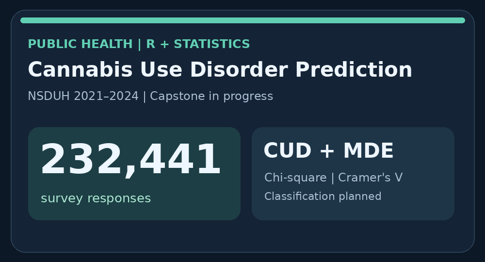
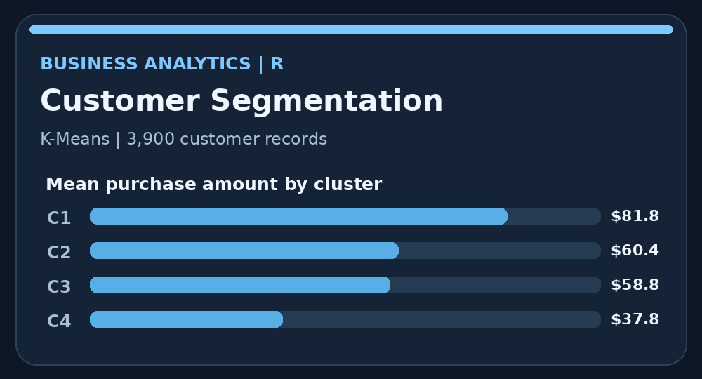
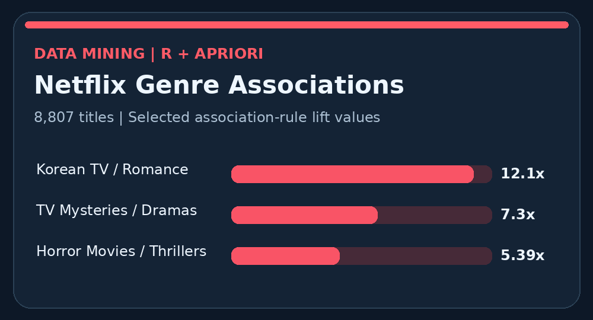
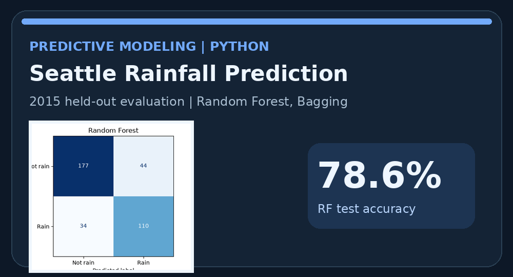
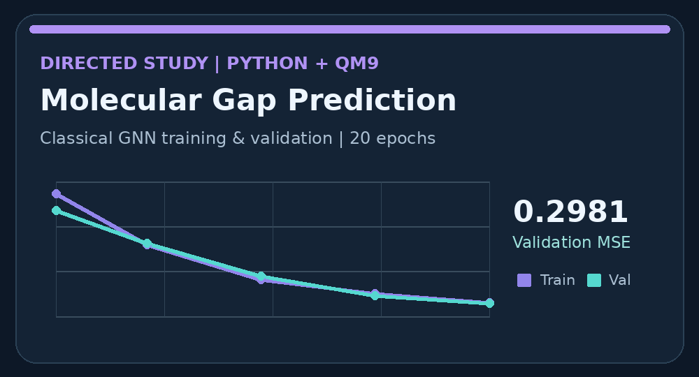
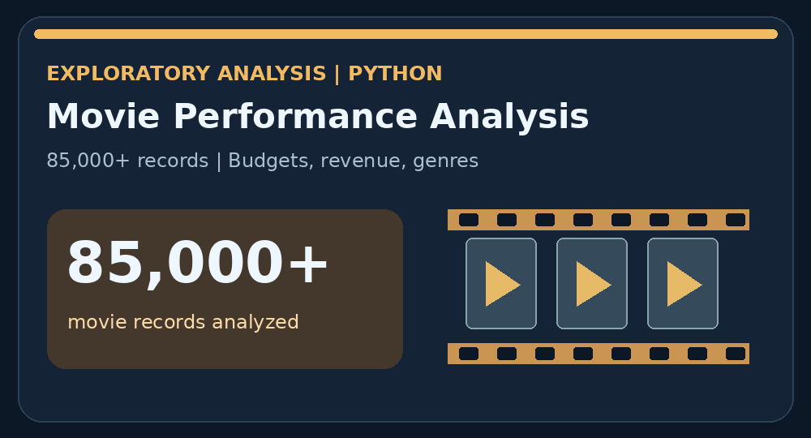

# Data Science Portfolio — Noemi Gaggiotti

Welcome to my Data Science Portfolio!

I am a Data Science student at Merrimack College, graduating in December 2026. My academic work focuses on data analytics, machine learning, statistical modeling, data visualization, and Geographic Information Systems (GIS).

This portfolio showcases projects completed throughout my undergraduate studies, including predictive modeling, business analytics, unsupervised machine learning, quantum machine learning research, and public health data analysis.

I am particularly interested in using data to solve real-world problems, identify meaningful patterns, and support data-driven decision-making in business, government, and research.

**Email:** gaggiottin@merrimack.edu, noemigaggiotti@gmail.com

**Location:** Andover, Massachusetts

---

## Achievements

- Bachelor of Science in Data Science, Merrimack College — Expected December 2026
- Cumulative GPA: 3.456
- Dean's List and President's List
- Completed an independent Directed Study in Quantum Machine Learning under Dr. Don Roosan, earning an A
- Completed Data Analysis for Business with an A-
- Experience analyzing large-scale public health data from the National Survey on Drug Use and Health (NSDUH)
- Fluent in English, Italian, and Spanish

---

## Technical Skills

**Programming Languages**
- Python
- R
- SQL

**Software and Tools**
- RStudio
- Tableau
- Microsoft Excel
- ArcGIS
- Google Colab
- Jupyter Notebook
- Google Workspace

**Data Analysis**
- Data Cleaning and Preprocessing
- Exploratory Data Analysis (EDA)
- Statistical Analysis
- Data Visualization
- Predictive Modeling
- Classification and Clustering
- Association Rule Mining
- Geographic Information Systems (GIS)

**Machine Learning**
- Logistic Regression
- Decision Trees
- Random Forest
- Bagging
- K-Means Clustering
- Hierarchical Clustering
- DBSCAN
- Graph Neural Networks (GNNs)

---

## Projects

This portfolio showcases selected academic projects in data science, business analytics, machine learning, statistical modeling, and Geographic Information Systems (GIS). These projects demonstrate my experience working with real-world datasets, applying analytical techniques, and communicating findings through data visualization.

<table>

<tr>
<td width="260" valign="top">

</td>
<td valign="top">
<h3><a href="cud-capstone-draft.Rmd">Cannabis Use Disorder Prediction — Data Science Capstone</a></h3>
<b>Technologies:</b> R, RStudio, Statistical Analysis, Machine Learning
  
<b>Status:</b> In Progress
  
Analyzing 232,441 survey responses from the 2021–2024 National Survey on Drug Use and Health (NSDUH) to investigate demographic, socioeconomic, mental-health, and substance-use predictors of Cannabis Use Disorder (CUD) and Major Depressive Episode (MDE).
  
Conducted exploratory data analysis, chi-square testing, and Cramér's V association analysis. Predictive modeling includes planned comparisons of logistic regression, decision trees, and random forests.
  
<a href="cud-capstone-draft.Rmd">View R Analysis Draft</a>
</td>
</tr>

<tr>
<td width="260" valign="top">

</td>
<td valign="top">
<h3><a href="customer-segmentation.md">Customer Shopping Behavior and Segmentation</a></h3>
<b>Technologies:</b> R, RStudio, ggplot2, K-Means, Hierarchical Clustering, DBSCAN
  
Analyzed a dataset containing 3,900 customer records and 16 variables to explore purchasing behavior and identify meaningful customer segments.
  
Performed data cleaning, exploratory analysis, min-max normalization, and clustering using multiple unsupervised machine learning techniques.
  
A four-cluster K-Means analysis identified differences in spending behavior, including clusters with average purchase amounts of approximately $81.80 and $37.80.
  
<a href="customer-segmentation.md">View Project Details</a>
</td>
</tr>

<tr>
<td width="260" valign="top">

</td>
<td valign="top">
<h3><a href="netflix-association.md">Netflix Genre Association Analysis</a></h3>
<b>Technologies:</b> R, RStudio, Apriori Algorithm, Association Rule Mining
  
Analyzed 8,807 Netflix titles to investigate relationships between genres using the Apriori algorithm and association rule mining.
  
Evaluated relationships using support, confidence, and lift to identify patterns in Netflix's content catalog.
  
A notable finding was the strong association between International Korean TV Shows and Romantic TV Shows, with a lift of approximately 12.1. The results suggest opportunities for more targeted content categorization.
  
<a href="netflix-association.md">View Project Details</a>
</td>
</tr>

<tr>
<td width="260" valign="top">

</td>
<td valign="top">
<h3><a href="Seattle_Rain_Homework3.ipynb">Seattle Rainfall Prediction Using Machine Learning</a></h3>
<b>Technologies:</b> Python, Pandas, scikit-learn, Matplotlib
  
Developed and evaluated machine learning models to predict rainfall using historical Seattle weather observations.
  
Compared Bagging and Random Forest classifiers, evaluated hyperparameter combinations using Out-of-Bag (OOB) accuracy, and assessed performance using a chronological train/test split.
  
The weather-informed Random Forest achieved 78.6% test accuracy, outperforming the calendar-only model, which achieved 58.1%.
  
<a href="Seattle_Rain_Homework3.ipynb">View Python Notebook and Results</a>
</td>
</tr>

<tr>
<td width="260" valign="top">

</td>
<td valign="top">
<h3><a href="quantum-directed-study.md">Quantum Machine Learning for Molecular Property Prediction</a></h3>
<b>Directed Study:</b> Dr. Don Roosan
 
<b>Technologies:</b> Python, Google Colab, Graph Neural Networks, QM9
  
Conducted independent research investigating classical Graph Neural Networks (GNNs), hybrid quantum-classical models, and DimeNet for predicting HOMO-LUMO molecular energy gaps.
  
Trained a classical GNN on the QM9 molecular dataset for 20 epochs, achieving a validation Mean Squared Error (MSE) of 0.2981.
  
Also explored a hybrid quantum-classical tutorial model, which reached a training MSE of 0.2924 after 10 epochs. Investigated DimeNet for its ability to incorporate molecular geometry into predictive modeling.
  
<b>Status:</b> DimeNet implementation remained in development.
  
<a href="quantum-directed-study.md">View Research Summary</a>
</td>
</tr>

<tr>
<td width="260" valign="top">

</td>
<td valign="top">
<h3><a href="movie-analysis.md">Movie Performance Analysis</a></h3>
<b>Technologies:</b> Python, Data Cleaning, Exploratory Data Analysis, Data Visualization
  
Analyzed more than 85,000 movie records to investigate relationships between production budgets, box office revenue, genres, runtimes, and audience engagement.
  
Performed data cleaning and exploratory analysis, creating scatter plots, bar charts, and boxplots to identify patterns in movie performance across approximately 25 years.
  
The project examined how movie characteristics relate to financial performance and demonstrated the use of visual analytics to communicate findings.
  
<a href="movie-analysis.md">View Project Details</a>
</td>
</tr>

<tr>
<td width="260" valign="top">

</td>
<td valign="top">
<h3>Amazon Rainforest Conservation GIS Module</h3>
<b>Technologies:</b> ArcGIS Online, Geographic Information Systems, Spatial Analysis
  
<b>Status:</b> In Progress
  
Designed an educational GIS module exploring spatial relationships between Indigenous territories and protected conservation areas throughout the Amazon rainforest.
  
The activity uses satellite imagery, geographic feature layers, and planned buffer and intersect analyses to explore conservation boundaries and spatial proximity.
  
The objective is to demonstrate how geographic analysis can support environmental research and the protection of Indigenous territories.
  
<i>ArcGIS map and final analysis link to be added upon completion.</i>
</td>
</tr>

</table>

*Project images illustrate analytical results or research topics. Projects still in development are identified as in progress.*

---

## Education

**Merrimack College**

Bachelor of Science in Data Science  
Expected Graduation: December 2026

**Relevant Coursework:**
- Foundations of Data Science I and II
- Data Mining and Predictive Analytics I and II
- Data Analysis for Business
- Creating Information Graphics
- Geographic Information Systems
- Optimization
- Modeling and Simulation
- Basic Statistics
- Calculus I
- Discrete Mathematics
- Problem Solving with Python

**Suffolk University**

Previous coursework in Communications, Journalism, Media Studies, Conflict Resolution, and Visual Communication.

---

## Career Interests

I am interested in opportunities involving:

- Data Analysis and Business Analytics
- Data Visualization and Reporting
- Predictive Analytics and Machine Learning
- Public Sector and Government Data Analysis
- Research and Statistical Analysis
- Geographic Information Systems

Thank you for visiting my portfolio!
